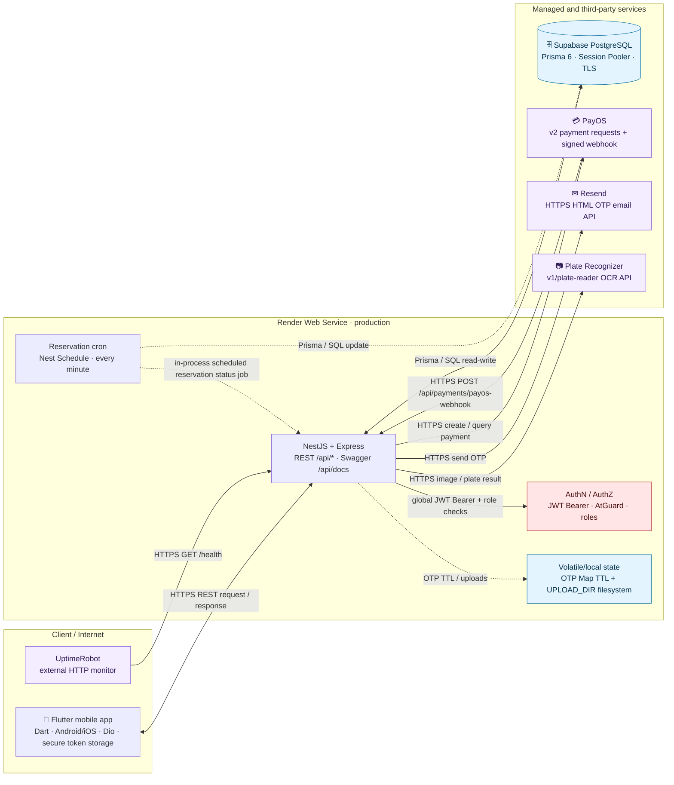

# System architecture — PRM393 Parking Management

## Phạm vi và luồng dữ liệu

| Luồng | Chiều và giao thức | Xử lý / dữ liệu |
|---|---|---|
| Request người dùng | Flutter mobile app (Android/iOS) ⇄ NestJS/Express qua HTTPS REST | Dio gọi `/api/*`; request được ValidationPipe kiểm tra, route protected qua JWT và quyền theo role; Prisma đọc/ghi PostgreSQL. |
| Thanh toán | API → PayOS qua HTTPS; PayOS → API qua HTTPS webhook | API tạo/tra cứu payment link. PayOS `POST /api/payments/payos-webhook`; backend xác minh webhook và cập nhật giao dịch. |
| Email OTP | API → Resend qua HTTPS | Đăng ký/reset gửi OTP HTML. OTP lưu `Map` in-memory, TTL 10 phút. |
| OCR bãi xe | API → Plate Recognizer qua HTTPS | Ảnh snapshot gửi đi, kết quả biển số quay về API; dữ liệu nghiệp vụ được ghi PostgreSQL. |
| Batch | Cron → service/DB trong cùng process | `@Cron('* * * * *')` xử lý trạng thái reservation; không phải worker độc lập. |
| Monitoring | UptimeRobot → Render qua HTTPS | Chỉ `GET /health` (HTTP liveness), không xác minh DB hay vendor integration. |

## Hợp đồng tích hợp chính

| Thành phần | Cấu hình / protocol được triển khai | Dữ liệu đi qua |
|---|---|---|
| Flutter mobile | Dio, JSON over HTTPS; base URL chuyển giữa Android emulator (`10.0.2.2`) và Render cloud; access token được interceptor gắn vào request | Credentials, JWT Bearer, DTO nghiệp vụ và response envelope. |
| Supabase | `DATABASE_URL` đến PostgreSQL Session Pooler với `sslmode=require`; Prisma Client 6.4.1 | User, role, reservation, payment, wallet, parking session, subscription, incident và các record nghiệp vụ. |
| PayOS | `POST https://api-merchant.payos.vn/v2/payment-requests`; client/API/checksum keys từ environment; webhook `POST /api/payments/payos-webhook` | Payment link, `orderCode`, trạng thái thanh toán; webhook phải được xác minh chữ ký trước khi ghi DB. |
| Resend | SDK Resend qua HTTPS; `RESEND_API_KEY`, `MAIL_FROM` | OTP HTML cho đăng ký và reset mật khẩu; không dùng SMTP. |
| Plate Recognizer | `POST /v1/plate-reader/`; API key, regions `vn`, confidence mặc định `0.75` | Ảnh snapshot vào dịch vụ OCR, kết quả biển số quay lại backend. |

## Thành phần không có bằng chứng trong codebase

- Client duy nhất trong phạm vi dự án là ứng dụng Flutter mobile (Android/iOS), dùng Dio. Không có web client triển khai; NestJS/Express là HTTP entry point, không phải API gateway độc lập.
- Không có worker tách riêng, queue/stream/event bus, Redis/cache, search engine, WebSocket hoặc gRPC.
- Không có object storage: upload hiện dùng filesystem `UPLOAD_DIR`; cần persistent disk nếu muốn giữ file sau redeploy.
- Không có LLM/AI runtime hoặc analytics service. Plate Recognizer là OCR của bên thứ ba.
- Không có container image, Docker Compose, Kubernetes/Terraform, hay CI/CD workflow được commit. Tài liệu production hướng dẫn Render Web Service và Supabase PostgreSQL; build/start bằng npm, Prisma generate và Nest build.
- Chưa có cấu hình metrics, distributed tracing, centralized logging hay alerting trong source. `UptimeRobot` là quan sát ngoài hệ thống ở mức HTTP health.

## Bảo mật và môi trường

- `JWT_ACCESS_SECRET`, `JWT_REFRESH_SECRET`, `DATABASE_URL` và khóa PayOS/Resend/OCR là environment secrets; không có secret trong sơ đồ hay source.
- Global `AtGuard` bảo vệ mặc định; route `@Public()` là ngoại lệ. ValidationPipe bật `whitelist` + `forbidNonWhitelisted`; CORS origin cấu hình qua `CORS_ORIGIN`.
- Môi trường được tài liệu hóa: `development`, `test`, `production`. Production: Render Web Service + Supabase Session Pooler, TLS (`sslmode=require`).

## Evidence

- `src/main.ts` — Nest/Express, ValidationPipe, Swagger, CORS và static upload.
- `src/app.module.ts` — global JWT guard và `ScheduleModule`.
- `src/reservations/reservations.service.ts` — reservation cron.
- `src/payments/payments.controller.ts` — PayOS webhook.
- `src/integrations/` và `src/auth/services/mail.service.ts` — PayOS, OCR, upload và Resend.
- `README.md` — Render/Supabase deployment và các giới hạn vận hành.
